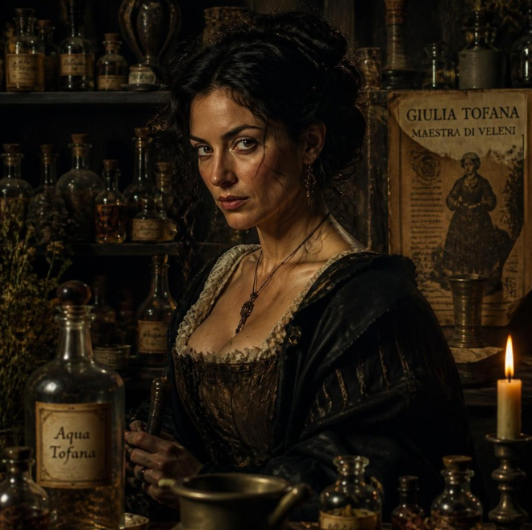
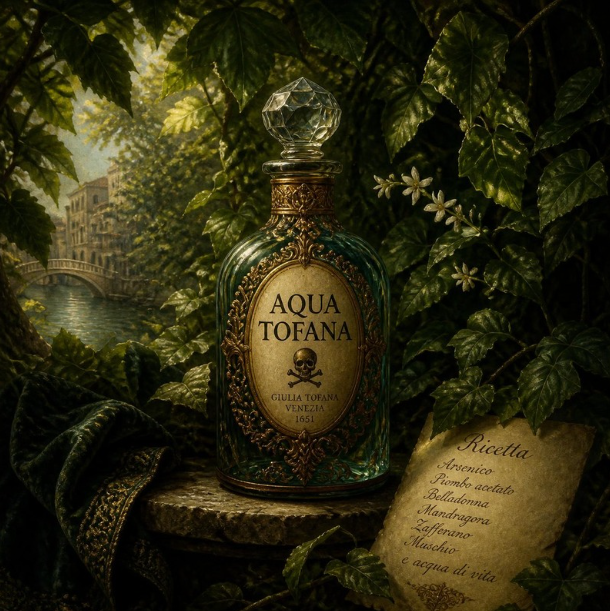
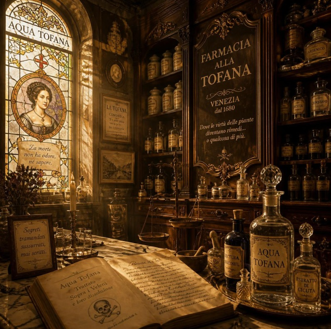

<table width="100%">
  <tr>
    <td valign="top" width="60%">
      
    </td>
    <td valign="top" width="40%">
      
Giulia Tofana who was born around the year 1620 and who died in 1651 in Italy is a fascinating figure of the 17th-century. She is remembered for orchestrating one of the most prolific poisoning networks in early modern Europe. In an era where women did not have many legal rights and thus were often trapped in abusive marriages. She provided a lethal escape route for hundreds of desperate wives.

    </td>
  </tr>
</table>
**The poisoner who saved hundreds of lives 📖**

## 🏛️ Myth vs. Historical Reality 🏛️
While pop culture and history often blur, modern research highlights key distinctions between the myth and the historical record:

*The Popular Legend*

According to the popular legend, she confessed to killing 600 men under brutal torture then got arrested, tortured, and publicly executed in Rome’s Campo de’ Fiori in 1659 
She is viewed strictly as one of history’s most prolific serial killers.

*The Historical Reality*

In fact, she died peacefully in her sleep in 1651, never having been convicted.
The famous 1659 trial actually prosecuted Gironima Spana and her network, who had inherited the formula.
It was seen by historians as a tragic, criminal response to a *suffocating patriarchal society*.

<table width="100%">
  <tr>
    <td valign="top" width="40%">
      <h3>💧 Aqua Tofana: The Perfect Weapon 💧</h3>
      
Giulia formulated a deadly poison known as **Aqua Tofana**. Its unique properties made it the ultimate tool for the perfect crime:
She used a lethal mixture of arsenic, lead, and belladonna. Those ingredients were completely colorless, odorless, and tasteless, making it easy to blend into water or wine.
Administered a few drops at a time over several days, it mimicked a slow, natural illness, leaving 17th-century doctors clueless*e.
**The Disguise:** The poison was sold disguised as a cosmetic face cream or in devotional vials labeled "Manna of St. Nicholas of Bari" to evade the authorities.

    </td>
    <td valign="top" width="60%">
      
    </td>
  </tr>
</table>

# 🥼 The Network and Impact 🥼
Operating first in Palermo and later in Rome, Giulia did not work alone. She surrounded herself with a trusted inner circle of women, including her stepdaughter (or close associate) **Gironima Spana**. 

Rumor has it they built a secretive word-of-mouth network. Historical estimates (largely derived from later trials) attribute the deaths of **over 600 men**—mostly abusive husbands—to her poison between 1633 and 1651.

  

### 🌟 Legacy and Pop Culture 🌟
The impact of Aqua Tofana echoed through the centuries. It heavily influenced France's infamous "Affair of the Poisons" during the reign of Louis XIV. Decades later, while on his deathbed in 1791, the legendary composer **Wolfgang Amadeus Mozart** famously claimed he was being poisoned with Aqua Tofana.

***
*Sources & Further Reading: [National Geographic](https://nationalgeographic.com) & [Wikipedia](https://wikipedia.org)*

***
*[Sally Basset's story](Second_page) --- [Baba Anujka](Third_page)
