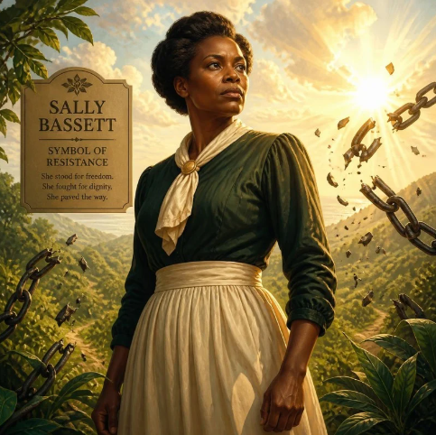
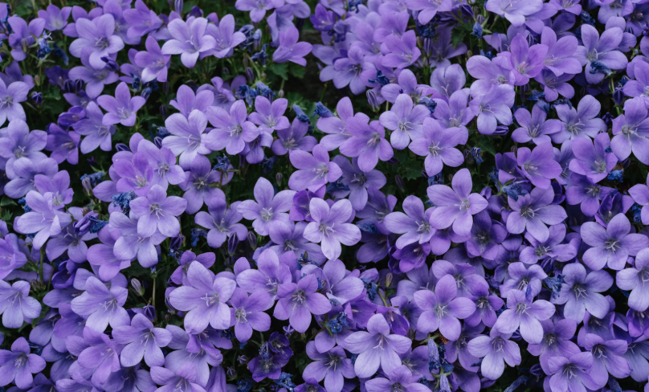
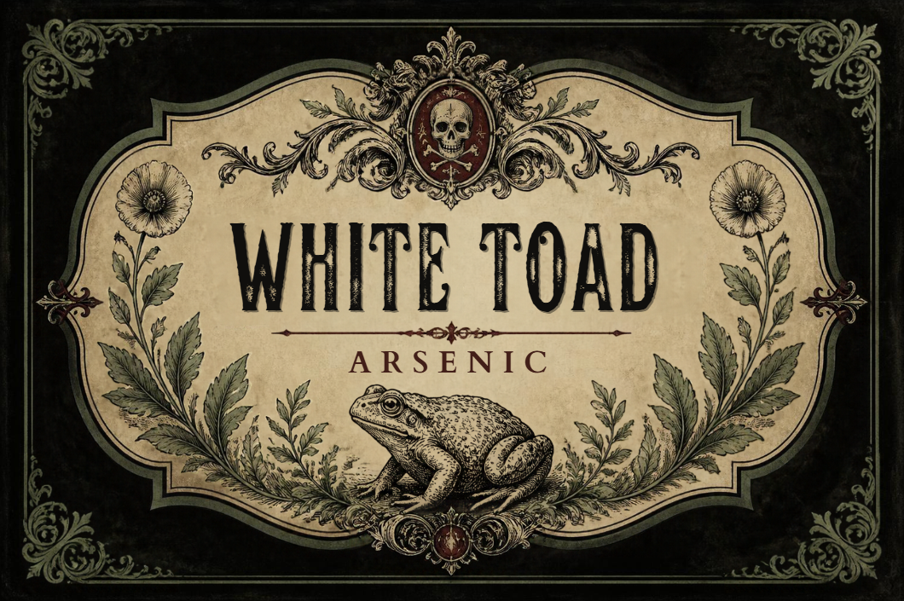
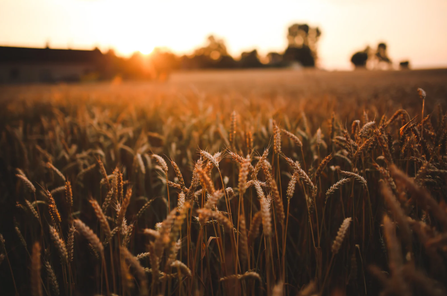

<link rel="stylesheet" href="{{ '/assets/css/style.css' | relative_url }}">
<table width="100%">
  <tr>
    <td valign="top" width="60%">
      
    </td>
    <td valign="top" width="40%">
      <h3>🔥Symbol of Resistance🔥</h3>
      
**Sarah "Sally" Bassett** who was born around 1700 1730 was an elderly, mixed-race enslaved woman in Bermuda whose life and execution made her one of the most powerful symbols of anti-slavery defiance in the Caribbean. At a time when enslaved people possessed absolutely no rights, her story chronicles a dark and complex form of resistance against colonial oppression.

    </td>
  </tr>
</table>
**📖 The poisoner who freed 📖**

## ⚖️ Myth vs. Historical Reality
The line between colonial records and local Bermudian folklore has blurred over nearly three centuries, creating two distinct perspectives on her fate:

_The Colonial Legend_

Condemned by a white male jury on June 5, 1730, after ten citizens and her granddaughter testified against her.
She was burned alive at the stake at Crow Lane on June 21, 1730.
A simple execution meant to suppress rebellion.

_The Historical Reality & Folklore_

The trial took place during severe economic decline and intense paranoia surrounding a potential slave revolt.
Sally maintained her innocence to the very end, famously declaring to the court, “I never deserved it.”
Legend says that when her ashes cleared, the Bermudiana (Bermuda’s national purple flower) miraculously sprouted from the stake.
 

## 💧The Herbal Warfare💧

  

In December 1729, Sally was accused of plotting to kill her granddaughter’s enslavers, Thomas and Sarah Foster, as well as an enslaved domestic woman named Nancey. The tools of the alleged crime relied heavily on traditional knowledge of regional toxins:
She used a combination of *ratsbane* (arsenic), *manchineel root* (a highly toxic tree native to the Caribbean), and a substance referred to in court as *"white toad"*.
Sally allegedly smuggled these lethal powders to her granddaughter, Beck, with instructions on how to lace the household's food and belongings.
Nancey discovered the poison, fell severely ill along with the Fosters, and alerted the local colonial authorities.

  

### 🌟 Legacy and Modern Culture

  

Sally Bassett’s execution deeply shaped the cultural identity of Bermuda. Even today, an exceptionally hot summer day in Bermuda is colloquially called **"a Sally Bassett day"**—originating from the rumor that she joked about the extreme heat on her way to the stake. 

In 2008, her status shifted from a historical criminal to an icon of freedom when the Bermudian government erected a 10-foot bronze monument titled **"The Spirit of Freedom"** in her honor on the grounds of the Cabinet Building in Hamilton.

-------------------------------

*Sources & Further Reading: [Enslaved.org](https://enslaved.org/fullStory/16-23-126830/) & [Wikipedia](https://wikipedia.org)*

[Giulia's story](First_page.md) --- [Baba Anujka's story](Third_page)

---
