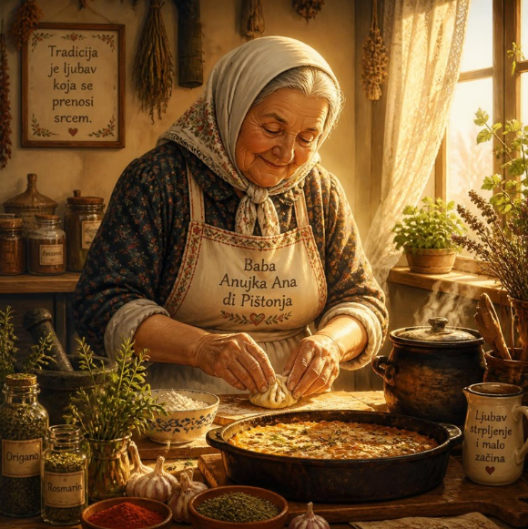
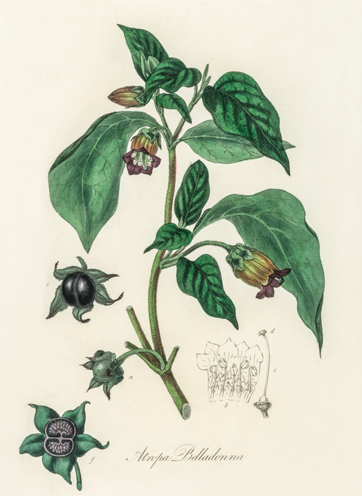
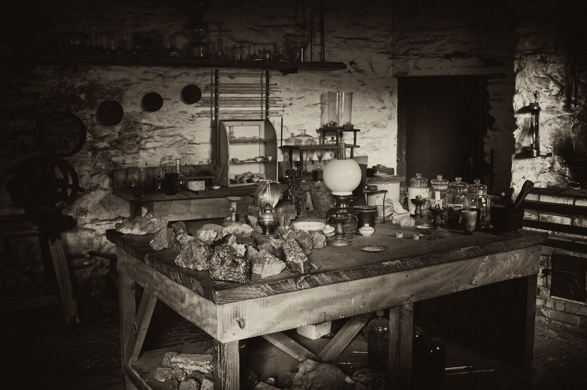
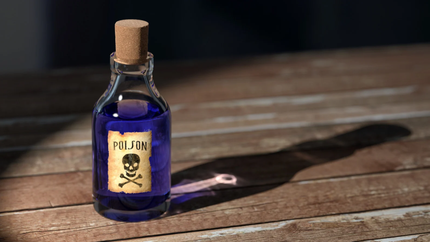

<link rel="stylesheet" href="{{ '/assets/css/style.css' | relative_url }}">
<table width="100%">
  <tr>
    <td valign="top" width="60%">
      
    </td>
    <td valign="top" width="40%">
      <h3> A Great Scientist</h3>
      
**Ana di Pištonja** (c. 1836/1838 – 1938), widely feared as **Baba Anujka** or the "Witch of Vladimirovac," was a Serbo-Romanian amateur chemist and convicted serial killer. Operating out of her home laboratory in a quiet village in modern-day Serbia, she became one of the world's oldest and most prolific female serial killers by offering a invisible chemical solution to unhappy wives.

    </td>
  </tr>
</table>

### 💧The "Magic Water"💧
<table width="100%">
  <tr>
    <td valign="top" width="40%">
      
Baba Anujka was highly educated, spoke five languages, and possessed an advanced understanding of chemistry and herbal medicine. She weaponized this knowledge into a concoction she named **"Magic Water"** (or *bajana vodica*):
It was a highly concentrated and lethal mixture of arsenic, zinc, lead, and toxic plant extracts like belladonna.
When a client approached her, Anujka would ask: *"How heavy is that problem?"* She was not asking about the emotional burden, but the actual body weight of the target to calculate the perfect lethal dose.
The toxin was designed to kill the target after exactly 7 or 8 days, making the death look entirely like a natural stroke or heart failure.

    </td>
    <td valign="top" width="60%">
      
    </td>
  </tr>
</table>

## 👥 The Business of Poison
After the death of her wealthy husband, Anujka turned her cottage into a profitable enterprise. She acted as an underground practitioner, treating ordinary ailments while secretly operating a word-of-mouth poisoning network for desperate or greedy clients. 

Between the late 19th century and her arrest in 1928, her "Magic Water" is estimated to have ended the lives of **50 to 150 men**—mostly abusive husbands or older family members holding inheritance.

  

### An underground lab

## ⚖️ Myth vs. Historical Reality
Nearly a century after her high-profile trial, historical digging separate the folklore from the documented court records:

_The Popular Legend_

A pure "witch" who hated men because an Austrian officer broke her heart and gave her syphilis at age 20.
She used dark magic, sorcery, and curses to kill her targets silently.
Executed or died chained up in a dark dungeon.

_The Historical Reality_

While the heartbreak occurred, her primary operation was a lucrative, cold, and calculating business that charged massive fees.
She was caught via forensic science in 1928 when bodies were exhumed after a client (Stana Momirov) confessed under interrogation.
Sentenced at age 90 to 15 years of hard labor. She was pardoned due to failing health after 8 years and died peacefully at home at 100 years old.

## 🌟 Legacy
Baba Anujka remains a terrifying figure in Balkan folklore, often cited as a prime historical example of how traditional herbalism could be distorted into deadly molecular warfare. Today, criminologists study her case as one of history's most chilling examples of a contract poisoner operating entirely under the guise of a harmless grandmother.

  

---------

<!-- CONTENEUR DES FEUILLES QUI TOMBENT -->

<!-- BOUTON DU MODE SOMBRE PARFAITEMENT ALIGNÉ -->

  <button id="theme-toggle" style="padding: 5px 12px; cursor: pointer; border-radius: 4px; border: 1px solid #ccc; background: transparent; color: inherit; font-size: 0.9rem;">🌙 Mode Sombre</button>

<!-- LE STYLE ET LE SCRIPT LOGIQUE SANS CONFLIT -->

*Sources & Further Reading: [All That's Interesting](https://allthatsinteresting.com/baba-anujka) & [Wikipedia](https://en.wikipedia.org/wiki/Baba_Anujka)*
---
[Giulia's story](First_page)---[Sally Basset's story](Second_page)
---
