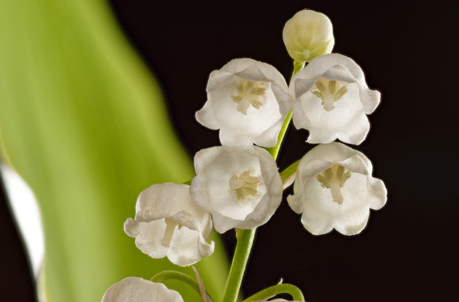

# Project Poisonous Flowers

   

 
  > *For centuries, women have been compared to flowers.*
> *Little did they know they were not so wrong to make such an accurate comparison. Much like the most captivating flora in nature, women possess a breathtaking beauty—but when threatened, some carry a lethal defense. On this site, you'll find three stories of three women who turned the traditional symbol of femininity into a weapon of survival, rebellion, and ultimate power.*

---

### 🌿 Table of contents 🌿

*   *[🧪The Legend of Giulia Tofana🧪](./First_page)*
*   *[🪻The Legend of Sally Bassett🪻](Second_page)*
*   *[🥀The Story of Baba Anujka🥀](Third_page)*

> [!WARNING] > **Disclaimer:** Please be aware that the following content are either historical facts or legends; I do not condone or encourage any of these methods. Additionally, sensitive topics such as domestic violence and poisoning are discussed, which might be distressing to some readers.

---

